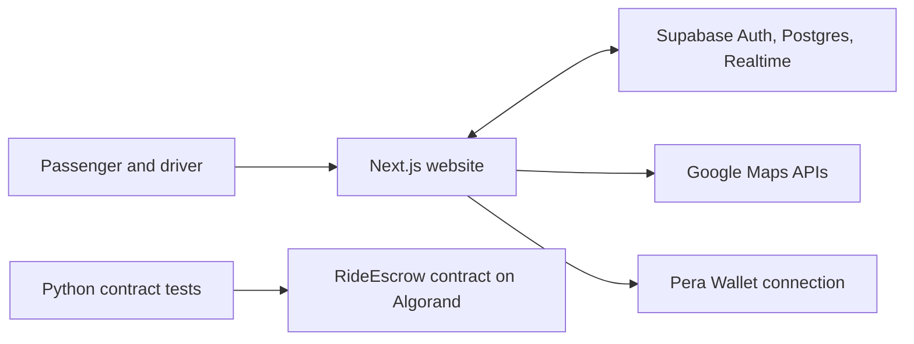

# Campus Ride

Campus Ride is a campus ridesharing project for students who need a lift and drivers who have a seat to share. Passengers request a ride, nearby drivers can accept it, and both sides follow its progress from their dashboards.

The repository contains two related projects. The **Next.js website** handles accounts, ride requests, and fare estimates. The **Algorand RideEscrow contract** implements an on-chain payment lifecycle and can be tested separately. **Website payments are currently disabled** while the contract is being integrated.

## Start with the demo

You can explore both roles without creating an account or configuring any services.

```sh
git clone https://github.com/madhur12031203/Campus-Ride---Algorand-Escrow-Ridesharing.git
cd Campus-Ride---Algorand-Escrow-Ridesharing
npm ci
npm run dev
```

Use Node.js 20.9 or newer and npm. Open [the local demo](http://localhost:3000/demo) and switch between **Passenger view** and **Driver view**. The demo uses sample data and creates no bookings.

| Page | What you can do |
| --- | --- |
| `/` | Learn about Campus Ride and choose to find or offer a ride |
| `/demo` | Explore the passenger and driver experience with sample data |
| `/login` | Choose your role, then sign in or create an account |
| `/dashboard` | Open the ride workspace |
| `/dashboard/book` | Request or accept rides and follow the active trip |
| `/dashboard/trips` | Filter your active and past rides |
| `/dashboard/wallet` | Manage the optional Pera Wallet connection |
| `/dashboard/profile` | See your account, ratings, and verification status |
| `/admin/verifications` | Review submitted verification documents with an authorized account |

## Run with real accounts and ride data

1. **Create a Supabase development project.** On a fresh database, run [`supabase/schema.sql`](supabase/schema.sql) first, then apply the [SQL migrations](supabase/migrations/) in filename order. The base schema creates the user table that the first migration references. The migrations add ride booking, verification, and realtime support.
2. **Copy the environment template.** Duplicate [`.env.example`](.env.example) as `.env.local` in the repository root. Fill in the settings for the features you plan to use.
3. **Configure sign-in.** Set the Supabase Site URL to the production site. Campus Ride builds its callback URL from the domain where sign-in starts, so allow the corresponding URLs for each trusted production, preview, or local domain in Supabase. For local testing these are `http://localhost:3000/auth/callback?role=passenger`, `http://localhost:3000/auth/callback?role=driver`, and `http://localhost:3000/auth/callback?mode=recovery`. If you enable Google sign-in, configure Google as a provider in Supabase.
4. **Configure optional services.** Follow the [Google Maps setup guide](GOOGLE_MAPS_API_SETUP.md) for autocomplete, geocoding, and route lookup. Follow the [verification storage guide](supabase/STORAGE_SETUP.md) if you want document uploads and manual reviews. The verification bucket must be private.
5. **Restart the app** with `npm run dev` after changing the environment file.

| Setting | Used for |
| --- | --- |
| `NEXT_PUBLIC_SUPABASE_URL` | Supabase project URL |
| `NEXT_PUBLIC_SUPABASE_PUBLISHABLE_KEY` | Public key for sign-in and database access under Supabase policies |
| `SUPABASE_SERVICE_ROLE_KEY` | Server-side account creation and admin verification endpoints. Keep it out of source control and browser code. |
| `GOOGLE_MAPS_API_KEY` | Server-side route and place lookups for fare comparison and booking |
| `NEXT_PUBLIC_GOOGLE_MAPS_API_KEY` | Browser-accessible key used by the ride screens for location features. Restrict it to your site and the APIs it uses. |
| `NEXT_PUBLIC_RIDE_ESCROW_APP_ID`, `NEXT_PUBLIC_RIDE_ESCROW_APP_ADDRESS` | App details required to enable the Pera Wallet panel. Check the values against your Testnet deployment. |
| `ADMIN_EMAILS` | Comma-separated list of verification reviewers |
| `GEMINI_API_KEY` | Optional server-side key for the chat assistant |

### Try a passenger and driver ride

Use two browser profiles so each account has its own session. A wallet is optional while escrow payments are disabled. If Google Maps is unavailable, enter the pickup, destination, and driver location as latitude and longitude.

1. Sign in as a passenger, enter a pickup and destination, and submit a ride request.
2. Sign in as a driver in the other browser profile and set a location near the passenger's pickup. The driver view filters requests within 8 km.
3. Accept the request from the driver dashboard. The passenger sees the update through Supabase Realtime.
4. Confirm completion from both dashboards. The website records the ride as completed in the database.

The legacy fare estimate API remains separate from the ride workspace.

## How the project fits together



| Location | What lives there |
| --- | --- |
| [`src/app/`](src/app/) | Next.js pages, auth callbacks, and server endpoints |
| [`src/components/`](src/components/) | Ride panels, account forms, navigation, and UI |
| [`src/lib/`](src/lib/) | Database queries, route lookups, pricing, and payment integration |
| [`supabase/`](supabase/) | Base schema, migrations, and verification storage instructions |
| [`smart_contracts/`](smart_contracts/) | Algorand Python contract, deployment configuration, and generated artifacts |
| [`tests/`](tests/) | Mock contract tests and on-chain LocalNet integration tests |

The web stack is Next.js, React, TypeScript, and Tailwind CSS. Supabase provides authentication, storage, and realtime data. The separate ARC-4 escrow contract is written in Algorand Python.

## Algorand escrow

The [`RideEscrow` contract](smart_contracts/ride_escrow/contract.py) keeps each ride's payment and state in Algorand box storage. A booking groups a payment for the fare and box funding with a contract call. The contract supports starting the ride, marking drop-off, and releasing the fare when the passenger confirms completion. It also has paths for cancellation, timeout claims, and dispute resolution. See the [contract design](DESIGN.md) for state transitions and payout rules.

The website does not currently submit those contract calls or verify settlement on-chain. A ride completed in Supabase records trip progress only. Integrating verified deposit and release transactions is the remaining payment work.

## Build and test

Check the website from the repository root.

```sh
npm run build
```

For the contract, install Python 3.12, Poetry, and AlgoKit. Docker is needed for LocalNet. Run these commands from the same repository root.

```sh
poetry install
poetry run python -m pip install pytest
poetry run python -m pytest tests/test_contract.py -v
algokit project run build
```

To run the integration tests against a local Algorand network:

```sh
algokit localnet start
poetry run python -m pytest tests/test_localnet_integration.py -v
```

The mock tests cover transaction guards and state transitions. The LocalNet suite exercises contract calls, fee requirements, box funding, and account balance changes.

## Troubleshooting

| If you see this | Check this first |
| --- | --- |
| Both sign-in methods fail to connect | Confirm the Supabase project is active and its Project URL resolves. Use that project's URL and publishable key together in the Vercel environment for the deployment you are testing, then redeploy. |
| Google sign-in fails before returning | Enable Google in Supabase and configure the Google OAuth client with the Supabase provider callback URL. See [Supabase's Google setup guide](https://supabase.com/docs/guides/auth/social-sign-in/auth-google). |
| Account services are not configured | Add the Supabase URL and publishable key to `.env.local`, then restart the app. |
| Sign-in redirects to the wrong site | Check that the callback for the site you opened is on the Supabase redirect allowlist. |
| Locations or fares are unavailable | Check the Maps keys, enabled APIs, and key restrictions. |
| A driver cannot see a request | Confirm the ride is waiting, the driver is within the pickup radius, and the realtime migrations are applied. |
| The wallet panel says setup is incomplete | Check the configured Algorand app ID and address. Payment settlement is separate and remains disabled. |

## Author

**Madhur Gupta** built Campus Ride, including the website, the ride coordination flow, and the Algorand escrow contract.
